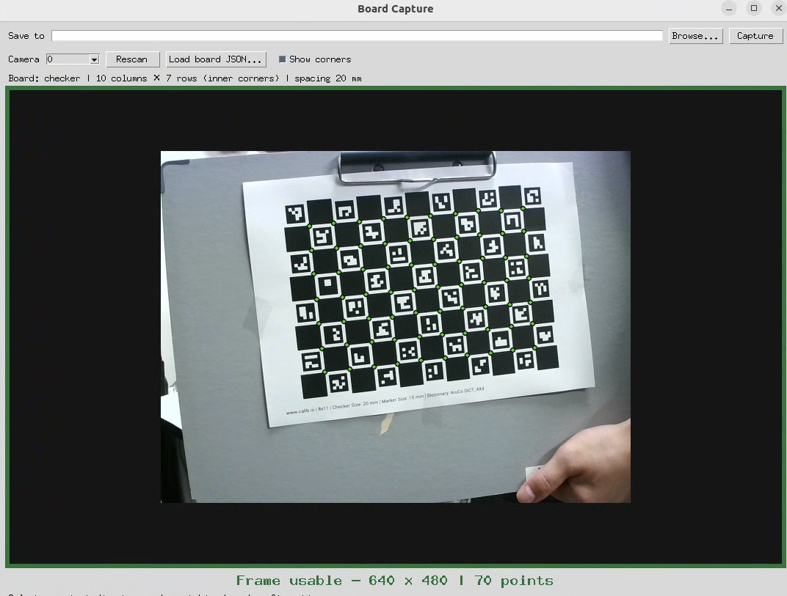
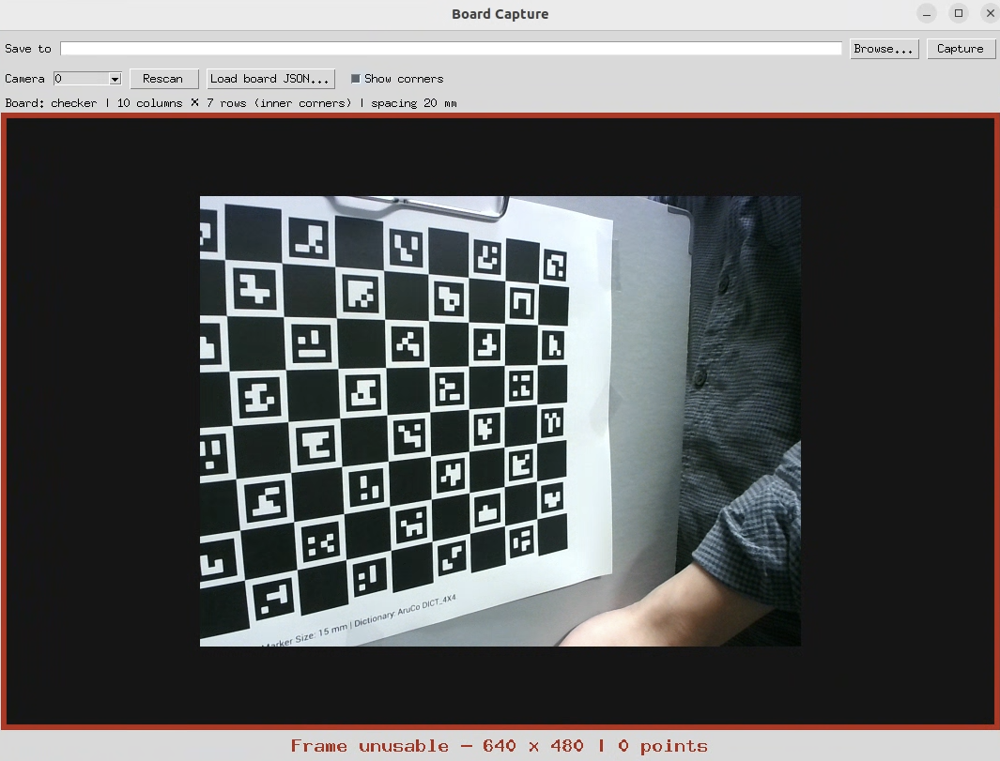

# Camera Calibration

[English](README.md) | **日本語**

Ubuntu / Windows 11向けの単眼カメラキャリブレーション・歪み除去ツールです。
Checkerboard、ChArUco、Kalibr形式AprilGrid、対称円、非対称円を使用できます。

- **キャリブレーション**: 画像ディレクトリを再帰探索して内部行列・歪み係数を推定し、JSONと補正前後の比較画像を出力します。補正済み画像を単独では保存しません。
- **ボード撮影**: カメラを自動検出し、デスクトップウィンドウで検出結果を確認しながら原画像を保存します。
- **歪み除去**: パラメータJSONで画像・動画を補正します。単一ファイル、ディレクトリとそのサブディレクトリに対応します。
- UbuntuではCLI、Windows 11では専用GUI実行ファイル3本を使用できます。Python環境があれば、どちらのOSでもCLI/GUIを起動できます。

OpenCVの **pinhole + 放射歪み3係数 / 接線歪み2係数** モデルを使用します。fisheye、ステレオ、カメラ・IMU同時推定には対応していません。AprilGridを使ってもKalibr自体を実行するわけではありません。

## ディレクトリ構成

このREADMEがある `camera_calibration/` を公開リポジトリのルートにしてください。親ディレクトリの既存データ・旧スクリプトは不要です。

```text
camera_calibration/
├── README.md                    # 英語版
├── README.ja.md                 # 日本語版
├── calibrate.py                 # キャリブレーションCLI
├── undistort.py                 # 歪み除去CLI
├── capture_gui.py               # ボード撮影GUI
├── calibration_gui.py           # キャリブレーションGUI
├── undistortion_gui.py          # 歪み除去GUI
├── camcal/
│   ├── capture.py               # カメラ探索・検出・撮影
│   ├── capture_gui.py           # ライブ撮影ウィンドウ
│   ├── boards.py                # ボードの幾何・検出
│   ├── calibration.py           # 推定・比較画像出力
│   ├── undistortion.py          # 画像・動画補正
│   ├── media.py                 # 入出力・再帰探索
│   ├── cli.py
│   └── gui.py
├── configs/                    # ボード設定の例
├── scripts/build_windows.ps1    # Windows実行ファイルのビルド
├── requirements*.txt
├── tests/                      # 合成画像・動画によるテスト
├── docs/implementation.md
└── .github/workflows/          # Ubuntuテスト・Windowsビルド
```

撮影画像・動画・個別カメラのパラメータは同梱しません。ローカル入力は `data/`、生成物は `outputs/` に置くとGit管理から除外されます。独自の場所を使う場合は公開前にGitの対象を確認してください。

## Ubuntuの環境構築

Ubuntu 22.04 / 24.04、Python 3.10〜3.12を想定しています。以下はこのREADMEのディレクトリで実行します。

```bash
sudo apt update
sudo apt install python3 python3-venv python3-tk libgl1 libglib2.0-0
python3 -m venv .venv
source .venv/bin/activate
python -m pip install --upgrade pip
python -m pip install -r requirements.txt
python calibrate.py --help
python undistort.py --help
```

`opencv-contrib-python` にChArUco/AprilTag機能が含まれます。同じ環境に `opencv-python` やheadless版を重複インストールしないでください。GUIの利用にはデスクトップ表示環境が必要です。

```bash
python capture_gui.py
python calibration_gui.py
python undistortion_gui.py
```

## Windows 11の環境構築・実行ファイル

### 配布済みexeを使う場合（Python不要）

Windowsビルドの成果物を展開し、以下を起動します。

- `BoardCapture.exe`: 保存先とボード設定JSONを指定して **Capture** で画像を保存。
- `CameraCalibration.exe`: 画像ディレクトリ・出力先・ボード種類と寸法を指定して「実行」。`configs/` のJSONを読み込むこともできます。
- `CameraUndistortion.exe`: 入力ファイルまたはディレクトリ・パラメータJSON・出力先を指定して「実行」。

出力先は「保存するファイル名」ではなくディレクトリです。キャリブレーションは新規または空のディレクトリを選んでください。処理状況とエラーはウィンドウ内に表示されます。

**ソースだけを取得した段階ではexeは含まれていません。** このリポジトリをルートとしてGitHubへ配置すると、Actionsの `Test and build Windows applications` がWindows上でビルドします。成功した実行のArtifactsから `camera-calibration-windows-x64` をダウンロードできます。ローカルで作る場合は次の手順を使用します。

### Windowsでビルドする場合

Python公式の **Python 3.11 x64** をインストールしてください。Tcl/Tkは標準インストールに含めます。PowerShellで以下を実行します。

```powershell
cd C:\path\to\camera_calibration
py -3.11 -m venv .venv
.\.venv\Scripts\Activate.ps1
python -m pip install --upgrade pip
powershell -ExecutionPolicy Bypass -File .\scripts\build_windows.ps1
```

venvの有効化が制限される場合は、そのPowerShellプロセスに限って `Set-ExecutionPolicy -Scope Process Bypass` を実行してください。

```text
dist/
├── BoardCapture.exe
├── CameraCalibration.exe
├── CameraUndistortion.exe
├── README.md
├── README.ja.md
└── configs/
```

PyInstallerのone-file形式で生成します。exeだけでも起動でき、設定例を使う場合は `configs/` も配布します。初回起動時は展開のため時間がかかることがあります。exeは署名していません。

Windows向けexeはWindows上でビルドしてください。[PyInstallerはクロスコンパイラではありません](https://pyinstaller.org/en/stable/operating-mode.html)。Ubuntu上でのテストはWindows exeの動作確認を兼ねません。

Pythonから使う場合は `python -m pip install -r requirements.txt` 後、Ubuntuと同じCLIまたはGUIコマンドを実行できます。

## ボード画像の撮影

```bash
python capture_gui.py

# ボード設定と保存先を指定して起動
python capture_gui.py --config configs/charuco_11x8_squares_20mm_15mm_legacy.json --output data/charuco
```

撮影GUIのラベルは英語です。上部バーに保存先の選択欄と **Capture** ボタンを配置しています。**Load board JSON...** で `configs/` の設定例または独自のボードJSONを読み込みます。初期設定は **内側交点10列×7行**（11列×8行のマス）、マス幅20 mmのチェッカーボードです。

- カメラ番号 **0〜9** を自動探索し、画像を読み込めた最初のカメラを選択します。**Camera** で切り替え、カメラを追加したら **Rescan** を押します。必要なら `--max-camera-index 20` で探索範囲を広げます。
- 設定したボードの検出が成功するとプレビューの周囲を**緑色**にして **Frame usable**、失敗すると**赤色**にして **Frame unusable** を表示します。カメラ未接続・切断時も赤色です。
- **Show corners** で検出点の可視化を切り替えられます。検出処理と保存画像には影響しません。
- **Capture** は表示中の判定済みフレームを、全解像度の原画像のまま日時付きPNGで保存します。検出点・プレビューの縮小・枠は保存画像に含めません。既存ファイルは上書きしません。
- 利用不可と判定された画像も撮影できます。キャリブレーション時に検出できない画像はスキップされます。利用可能の表示はボード検出が成功したという意味で、ピント・姿勢の多様性・最終的な較正精度を保証するものではありません。
- カメラまたはボード設定を変更した直後は、新しい判定が届くまで撮影対象をクリアします。カメラ読込と検出はGUIと別のスレッドで行います。プレビュー速度はカメラと検出時間に依存します。

カメラの既定の撮影解像度を使用し、ステータス欄に実際のサイズを表示します。補正予定の画像・動画と解像度を揃えてください。認識できない場合は他のカメラ使用アプリを閉じ、OSのプライバシー設定でカメラへのアクセスを許可してください。一部のドライバーでは接続・解放に時間がかかります。カメラ番号は再接続で変わることがあり、永続的なデバイスIDではありません。[OpenCV VideoCapture](https://docs.opencv.org/4.10.0/d8/dfe/classcv_1_1VideoCapture.html)も参照できます。

撮影後は同じボード設定で、選んだ保存先を入力として `calibrate.py` を実行してください。

### キャリブレーションに使用する画像の例

以下は **checker検出・内側交点10列×7行** に設定した場合の例です。必要な交点が鮮明に写るように撮影してください。

| 利用可能な画像 | 利用不可の画像 |
|---|---|
|  |  |
| **キャリブレーションに使用可能：** 必要な内側交点70個をすべて検出できています。緑色の枠と **Frame usable** が検出成功を示します。 | **この設定では使用不可：** ボードの一部が画角外にあり、必要な交点の格子を検出できていません。赤色の枠と **Frame unusable** が検出失敗を示します。 |

利用可能の判定だけで較正精度が保証されるわけではありません。ピントを合わせ、ボードの位置・距離・傾きを変えた画像を集めてください。ChArUco・AprilGridでは、ボードが部分的に写った場合の受け入れ条件が異なります。

## ボードの特徴

- **Checkerboard**: 印刷しやすく、交点を高精度に検出できます。基本的に指定した内側交点の全体が写る必要があります。列数・行数とマス数を混同しないようにします。
- **ChArUco**: チェッカー交点とArUcoのIDを組み合わせます。部分的に隠れても対応点を識別でき、複数姿勢の撮影に便利です。辞書、マス数、マーカー寸法、旧形式の有無を印刷物と一致させます。
- **Kalibr / AprilGrid**: AprilTagのIDと四隅を使います。部分表示でも利用でき、複数カメラ・IMUの較正にも一般的に使われます。このツールでは単眼推定のみを行います。
- **Circles（対称円）**: 規則的な円中心を使います。ぼけに比較的強い一方、強い傾きによる楕円化や対称性による曖昧さに注意が必要です。
- **Asymmetric circles（非対称円）**: 千鳥状の配置で向きの曖昧さを減らせます。円の中心間隔の定義が対称円と異なるので、実物の座標配置を確認します。

## ボード設定

寸法の単位は **mm** です。ボード全体の紙幅・紙高さ・余白ではなく、実際のマスや円中心・タグの寸法を使います。印刷時は「用紙に合わせる」を無効にし、実寸を測ってください。

| `type` | `columns` / `rows` | `spacing_mm` |
|---|---|---|
| `checker` | **内側交点**の列数・行数 | マスの一辺 |
| `charuco` | **マス**の列数・行数 | マスの一辺 |
| `aprilgrid` | タグの列数・行数 | タグの黒枠外形の一辺 |
| `circles` | 円中心の列数・行数 | 水平・垂直の中心間隔 |
| `asymmetric_circles` | 各行の円数・行数 | 下記座標式の `d` |

非対称円は0始まりの列 `c`・行 `r` に対して `x=(2*c+r%2)*d, y=r*d` です。同じ行の隣の円までの距離は `2*d`、行間隔と横ずれは `d`、斜めの隣接距離は `sqrt(2)*d` です。

### Checkerboardの例

11列×8行の**マス**、マス幅20 mmなら内側交点は10列×7行です。

```json
{
  "type": "checker",
  "columns": 10,
  "rows": 7,
  "spacing_mm": 20
}
```

### ChArUcoの例

```json
{
  "type": "charuco",
  "columns": 11,
  "rows": 8,
  "spacing_mm": 20,
  "marker_mm": 15,
  "dictionary": "DICT_4X4_50",
  "legacy_pattern": true
}
```

`DICT_4X4` だけでは辞書は一意になりません。`DICT_4X4_50` / `_100` / `_250` / `_1000` など印刷時に選んだものを指定します。IDの小さい部分が共通する辞書もあるため、画像だけで元の辞書容量を断定できないことがあります。

`legacy_pattern` は通常 `false`。OpenCV 4.6より前と互換の偶数行パターンでは `true` を使います。[公式の旧形式説明](https://docs.opencv.org/4.10.0/d0/d3c/classcv_1_1aruco_1_1CharucoBoard.html)も参照してください。間違えるとマーカーが見えていても交点を取得できません。

### Kalibr AprilGridの例

```json
{
  "type": "aprilgrid",
  "columns": 6,
  "rows": 6,
  "spacing_mm": 20,
  "tag_spacing": 0.3,
  "first_id": 0,
  "border_bits": 2
}
```

`tag_spacing` は **タグ間の隙間 / タグ幅**。上の例では隙間6 mm、ピッチ26 mmです。Kalibr YAMLの `tagCols`, `tagRows`, `tagSize`（m）, `tagSpacing` を、このJSONへ換算して指定できます。YAMLを直接読み込む機能はありません。

`border_bits` は黒枠の太さ（bit数）で、Kalibr標準は **2** です。1-bit版の印刷物なら1に変更してください。タグの回転はKalibr標準（OpenCV生成マーカーから180度回転）を前提とします。

対象は **tag36h11**、ID昇順・同じ回転の標準Kalibr配置です。ID 0（または `first_id`）は左下、右方向に増え、次に上の行へ進みます。独自にタグを回転・入れ替えたボードには対応しません。[Kalibrのボード説明](https://github.com/ethz-asl/kalibr/wiki/Calibration-targets)、[座標実装](https://github.com/ethz-asl/kalibr/blob/master/aslam_cv/aslam_cameras_april/src/GridCalibrationTargetAprilgrid.cpp)を参照してください。

## キャリブレーションの実行

同じカメラ・解像度・フォーカス・ズームで撮影します。ボードは平らに固定し、距離・傾き・画面内の位置を変え、画面端にも写します。似た連続フレームを増やすより、異なる姿勢の鮮明な画像を10〜30枚以上集めてください。極端なブレ・反射・ボードの反りは避けます。

```bash
python calibrate.py data/checker \
  --config configs/checker_11x8_squares_20mm.json \
  --output outputs/checker_run

python calibrate.py data/charuco \
  --config configs/charuco_11x8_squares_20mm_15mm_legacy.json \
  --output outputs/charuco_run
```

PowerShellでは上記を1行にするか、行末の `\` をバッククォートに置き換えてください。

- 全サブディレクトリの画像を対象とします。対応画像: JPG/JPEG/PNG/BMP/TIF/TIFF/WebP（拡張子の大文字小文字は不問）。シンボリックリンクのファイルは対象外です。
- 検出成功10枚以上が標準条件です。検出できない画像や破損画像は理由を記録してスキップします。異なる解像度の混在はエラーにします。
- `--min-images N` で最低枚数を変更できます（下限3、通常は10以上）。ChArUcoは非共線の6交点以上、AprilGridは2タグ以上を必要とします。
- 接線歪みは既定でゼロ固定です。`--estimate-tangential` を付けると推定します。
- 実行ごとに新しい、または空の出力ディレクトリを指定してください。既存結果は上書きしません。

```text
outputs/checker_run/
├── camera_params.json
└── comparisons/
    ├── photo01.jpg.jpg          # 入力ファイル名 + .jpg
    └── subfolder/
        └── photo02.png.jpg
```

比較画像は **左: 元画像 / 右: 補正後（alpha=0）**。各パネルは最大幅960 pxのプレビューで、推定自体は元の解像度を使用します。比較画像は検出成功画像に対して生成します。補正済み単独画像・交点描画画像は生成しません。

`camera_params.json` には以下を保存します。

- `camera_matrix`: `[[fx,0,cx],[0,fy,cy],[0,0,1]]`（pixel単位）
- `dist_coeffs`: `[k1,k2,p1,p2,k3]`
- `image_size`: `[width,height]`
- `rms_error`: 全対応点の再投影RMS（pixel）
- `per_image_rms_px`, `points_per_image`: 使用画像ごとのRMS・交点数
- `images_used`, `detection_results`: 使用画像、全入力の検出結果・スキップ理由
- `board`, `calibration_flags`, `opencv_version`: 再現に必要な設定

画像ごとの点数が違う場合、全体RMSは点数で重み付けした二乗平均平方根になります。RMSは学習画像への当てはまりであり、歪み量や実空間mm誤差そのものではありません。未使用画像の直線や実測寸法でも確認してください。

## 画像・動画の歪み除去

単独の補正画像が必要な場合は、こちらの専用コマンドを使用します。

```bash
# 単一画像
python undistort.py data/photo.jpg --params outputs/charuco_run/camera_params.json --output outputs/corrected

# 単一動画
python undistort.py data/movie.mp4 --params outputs/charuco_run/camera_params.json --output outputs/corrected

# ディレクトリ配下の画像・動画をすべて再帰処理
python undistort.py data/session --params outputs/charuco_run/camera_params.json --output outputs/corrected
```

ディレクトリ入力は、指定した入力ルート名とその配下の構造を維持します。

```text
入力                              出力先: outputs/corrected
 data/session/                     outputs/corrected/session/
 ├── photo.jpg                     ├── photo.jpg
 ├── camera_a/                     ├── camera_a/
 │   ├── clip.avi                   │   ├── clip.mp4
 │   └── nested/x.png               │   └── nested/x.png
 └── camera_b/clip.mov              └── camera_b/clip.mp4
```

単一ファイルの場合は `出力先/入力ファイル名` です。画像の拡張子は維持し、動画は常に `.mp4` に変換します。動画入力はMP4/AVI/MOV/MKV/TS/MPG/MPEG/WMV/M4Vに対応しますが、読み書きできるコーデックはOpenCVの環境に依存します。

- 解像度は既定で推定時と一致する必要があります。異なる場合はエラーです。
- 同じ画角を単純リサイズした素材に限り、`--scale-intrinsics` で `fx,fy,cx,cy` を拡大縮小できます。クロップ・ズーム・センサーモード変更には使えません。
- `--alpha 0`（既定）は黒縁を減らすため画角を狭め、`--alpha 1` は画角を残すため黒縁を許容します。出力の縦横ピクセル数は維持し、ROIによる追加切り抜きは行いません。
- 動画は `mp4v`、元のFPSの**固定フレームレート・音声なし**で再エンコードします。音声、可変FPSのタイムスタンプ、メタデータは保持しません。奇数の動画幅・高さはコーデックによる切り捨てを避けるためエラーにします。
- 入力内への出力、既存出力の上書き、動画の拡張子変換による名前の衝突（例: `clip.avi` と `clip.mov`）はエラーです。エラー時は処理を停止し、それ以前に完了したファイルは残ります。
- サブディレクトリに複数のカメラが混在している場合も、1回の実行では同じパラメータを適用します。異なるカメラは別々に実行してください。

既存スクリプトが出力した `camera_matrix` / `dist_coeffs` / `image_size` を含むJSONも読み込めます。歪み係数の1次元・2次元配列に対応します。

## テスト

```bash
python -m pip install -r requirements-dev.txt
python -m pytest -q
```

5種類の合成ボードの検出・AprilGridの対応点配置、推定と比較画像出力、再帰構造、日本語の画像パス、動画出力、解像度不一致、上書き・衝突の防止をテストします。GUIテストは表示環境がないUbuntuではスキップし、Windows CIでは実行します。検証実績と未検証範囲は [docs/validation.md](docs/validation.md) に記録しています。実カメラの精度、Windows上のGUI操作、全動画コーデックの動作は利用環境でも確認してください。

公開時のライセンスは権利者が選んで `LICENSE` を追加してください。本ディレクトリではプロジェクトのライセンスを自動決定していません。
